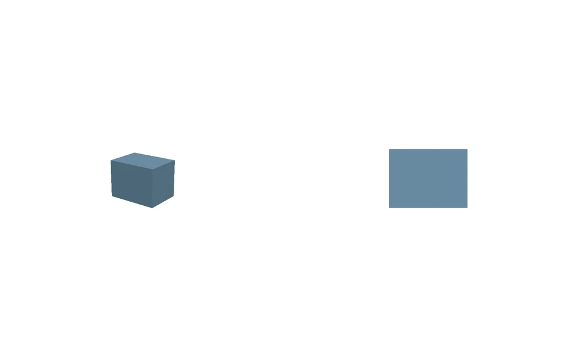
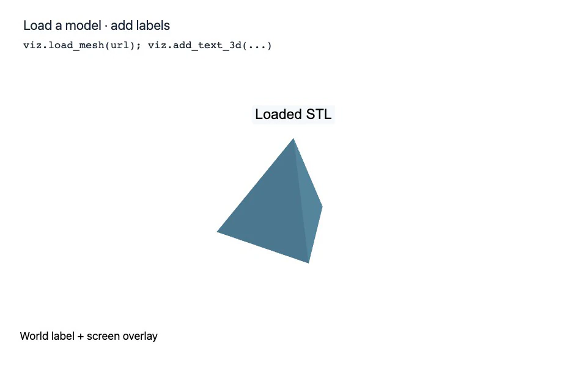
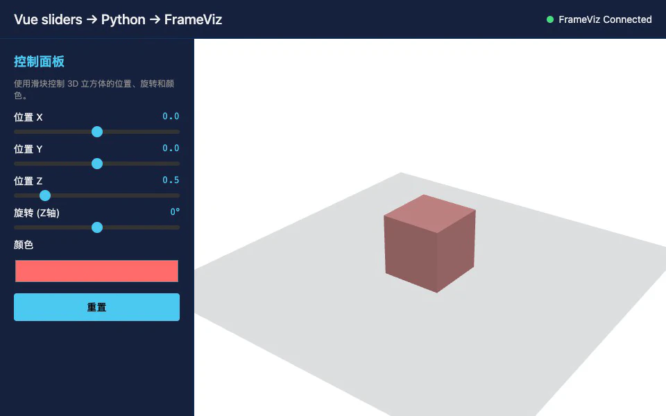

# FrameViz

[中文](README.zh-CN.md) · [Examples](examples/README.md) · [API contract](docs/API_Definition.md) · [Changelog](CHANGELOG.md)

Draw and interact with 3D data from **Python or C++**, in a desktop window, browser, or your **Vue** application. FrameViz provides object handles, NumPy/array input, instancing, camera control, picking events, and transform handles. A local Rust Host keeps scene state; a Three.js viewer renders it.

Version **0.5.0**, development candidate. Copyright **qqfly**, [MIT](LICENSE). Third-party attribution: [NOTICE](NOTICE) and [THIRD_PARTY_LICENSES](THIRD_PARTY_LICENSES).

## What can I draw?


| Data or object | Python | C++ | Input |
|---|---|---|---|
| Coordinate frames | `add_axes` | `addAxes` | Length, radius, pose |
| Point clouds | `add_points` | `addPoints` | N×3 positions, optional RGB colors |
| Lines | `add_lines` | `addLines` | Positions, optional segment indices |
| Box, sphere, cylinder, cone, arrow, plane | `add_box`, `add_sphere`, … | `addBox`, `addSphere`, … | Dimensions, pose, color |
| Indexed meshes | `add_mesh` | `addMesh` | Vertices, triangle/polygon faces, optional normals and vertex/face colors |
| Model files | `load_mesh` | `loadMesh` | Served STL or DAE URL |
| Repeated primitives | `add_instances` | `addInstances` | Box/sphere/axes, per-instance positions, orientations, scales and RGB |
| World labels / screen overlays | `add_text_3d` / `add_text_2d` | `addText3D` / `addText2D` | Text, world position / pixel coordinates |

Coordinates and dimensions come from your application. Quaternions use **`[x, y, z, w]`**. See the [API contract](docs/API_Definition.md), [Python signatures](packages/frameviz-py/frameviz/viz.py), and [C++ signatures](packages/frameviz-cpp/include/frameviz/viz.hpp).

## Quick start

Install the runtime once, then install its paired Python SDK wheel in each project environment:

| Environment | Runtime | Viewer |
|---|---|---|
| Apple Silicon Mac | Private-preview `FrameViz.app` from the [releases](https://github.com/qqfly/frameviz/releases) | Native window by default |
| Windows x64 desktop | Matching App and SDK. See the [Windows trial instructions](docs/INSTALLATION.md#windows-x64-trial). | Native window by default |
| Ubuntu 22.04 / 24.04 x86_64 desktop | Matching preview `.deb`: `sudo apt install ./FrameViz_*.deb` | Native window by default |
| Linux without a desktop | Extract the standalone archive; copy its `frameviz-server` to `~/.local/bin/frameviz-server` | Printed private browser link; SSH forwarding for remote use |

```sh
python3 -m venv .venv
source .venv/bin/activate
python -m pip install /path/to/frameviz-0.5.0-py3-none-any.whl
```

In IPython or a Python session:

```python
import frameviz as fv
viz = fv.open()
viz.add_box()
```

A running compatible runtime is reused. Python can start a known macOS or Linux installation automatically. For a Windows cold start, set `FRAMEVIZ_TAURI_APP` to the installed executable in the current PowerShell session. The C++ SDK can discover the installed Windows App automatically. In a standalone Python script, end with `viz.keep_running()`. Ctrl+C closes the view and connection. Use `fv.open(window_mode=1)` to open a browser or `window_mode=0` to manage pages yourself. Without a Linux desktop, FrameViz prints the private link automatically. Browser mode reuses the managed page and keeps scenes independent. Use `reuse_browser=False` to keep separate pages.

The existing Mac preview is ad-hoc signed and **not Apple-notarized**. Ubuntu build/container checks and native desktop/GPU acceptance are different results; the latest artifact and test records determine which has run. See [installation and source builds](docs/INSTALLATION.md), [Mac first-open steps](docs/MACOS.md), and [troubleshooting](docs/TROUBLESHOOTING.md).

The SDK is pip-installable from a wheel or source. Public `pip install frameviz` is not an advertised installation entry yet; the current delivery keeps runtime installation separate. [Python distribution](docs/PYTHON_DISTRIBUTION.md).

## Developer examples

These are real SDK → Host → viewer captures. Origin helper axes are hidden; the Axes drawing example and functional Gizmo handles remain visible. Basic scenes use synthetic data; SO-101 uses the credited external model with synthetic joint inputs. The recordings are not performance benchmarks. [Capture notes and source mapping](docs/media/README.md).

### Color, transparency, visibility, and pose

Keep an object handle and update it:

```python
viz.set_color(box, (0.9, 0.25, 0.35))
viz.set_alpha(box, 0.25)
viz.set_visible(box, False)
viz.set_visible(box, True)
viz.set_transform(box, pos=(0.4, 0, 0.65))
# viz.remove(box) removes one object; viz.clear() clears the scene.
```


Examples: [colors and transparency](examples/python/01_basic_primitives/use_colors_and_transparency.py), [batch transforms](examples/python/05_scene/use_batch_transforms.py), [object lifecycle](examples/python/05_scene/use_object_lifecycle.py).

### Mesh data, vertex colors, and wireframe

Pass `float32` vertices and `uint32` triangle indices. Use `colors` for vertex/face RGB, or `color` for a uniform material. `set_color` switches to a uniform color without retaining the old vertex palette.

```python
mesh = viz.add_mesh(vertices, faces, colors=colors, smooth_shading=True)
viz.set_color(mesh, (0.2, 0.55, 0.8))
viz.set_render_mode("wireframe")  # View-level display mode
```


Try the [mesh color modes](examples/python/01_basic_primitives/use_mesh_color_modes.py),
[transparency and wireframe](examples/python/01_basic_primitives/use_mesh_transparency.py),
and [smooth shading](examples/python/01_basic_primitives/use_mesh_smooth_shading.py) examples.

### Instancing and batch updates

Use one handle for repeated primitives. Provided arrays replace their previous contents. The example updates positions, colors and the number of instances.

```python
h = viz.add_instances("box", positions=positions, size=(0.22, 0.22, 0.22), colors=colors)
viz.update_instances(h, positions=next_positions, colors=next_colors)
```


Try the [instancing example](examples/python/01_basic_primitives/use_instancing.py).

### Picking and Gizmo events

Register callbacks, enable picking, and attach transform handles to a selected object. Python dispatches callbacks automatically on a dedicated background thread. Synchronous SDK calls are supported inside callbacks; protect state shared with your own threads. In IPython no lifetime call is needed. In a standalone script, use `keep_running()`. Set `auto_events=False` when your application needs to dispatch callbacks itself with `poll_events()`.

```python
viz.set_pick_config(enabled=True, mode="object", button=0)
def picked(event):
    if event.get("handle"):
        viz.attach_gizmo(event["handle"], mask=0x07)  # Translation axes
viz.on_pick(picked)
viz.on_transform(lambda event: print(event))
viz.keep_running()
```


Try the [Gizmo example](examples/python/03_interaction/use_gizmo.py) and [object or point picking](examples/python/03_interaction/use_picking.py).

### Shared scene, independent cameras

Object updates appear in every view bound to a scene; each view keeps its own camera. Separate scenes have independent object sets.

```python
second = fv.open(title="Top view", share_scene=viz.scene_id)
second.set_view_config(show_axes=False)
second.set_camera_pose(eye=(0.01, 0, 8), target=(0, 0, 0.4), up=(0, 1, 0))
```



Examples: [multiple views](examples/python/02_camera_views/use_multi_view.py) (use `--independent` for scene isolation), [camera controls and fit](examples/python/02_camera_views/use_camera_controls_fit_object.py).

### Model URLs and text labels

Load **STL or DAE** from a served URL. The browser loads the model: an arbitrary path on the Python machine is not a model URL. Cross-origin servers must allow the viewer's request. World labels use 3D positions; overlays use screen pixels.

```python
model = viz.load_mesh("http://127.0.0.1:8000/model.stl", color=(0.2, 0.55, 0.8))
label = viz.add_text_3d("Loaded STL", pos=(0, 0, 1.5), color="black")
viz.update_text_3d(label, text="Updated", pos=(0.5, 0, 1.5))
viz.add_text_2d("Status: ready", x=32, y=540, color="black")
```



Try the [model and labels example](examples/python/01_basic_primitives/use_load_mesh_and_labels.py) with the bundled pyramid. See the [C++ command](examples/README.md#模型与文字).

### Vue controls → Python backend → 3D scene

Embed the viewer beside real application controls. This uses the existing [Simple Slider application](examples/apps/simple_slider/README.md): X/Y/Z sliders move the box, a fourth slider rotates it, and Reset restores its initial pose.

```vue
<ControlPanel :box-handle="boxHandle" @update-transform="handleUpdateTransform" />
<FrameVizViewer name="simple_slider_viewer" :view-id="viewId" />
```

The panel sends `set_box_pose` to the authenticated Python business backend, which calls `viz.set_transform(handle, pos=..., quat=...)`. The viewer renders the Host's updated scene. Host and business credentials are separate and supplied at runtime.



After source dependencies, the Python SDK and matching App/Host are available:

```sh
python -m pip install -r examples/apps/simple_slider/python/requirements.txt
pnpm --filter simple-slider-app build
python examples/apps/simple_slider/python/run_browser_demo.py
```

The launcher opens the local page with fresh temporary credentials; press Enter in its terminal to stop the demo. See [startup details and dataflow](examples/apps/simple_slider/README.md), [control panel](examples/apps/simple_slider/src/components/ControlPanel.vue), [Python backend](examples/apps/simple_slider/python/backend_simple_slider.py), and [Vue SDK](packages/frameviz-vue/README.md). The [minimal component example](examples/vue/README.md) remains available for initial embedding. The robot joint-control application is another integration example; its shipped public meshes are placeholder fixtures, not a physical robot model.


### SO-101 robot model and joint controls

Use an articulated robot model with the same viewer and object-pose APIs. This recording shows **five SO-101 arm joints plus its gripper**, operated from Vue controls, with reset to the initial pose. SO-101 is an officially supported [LeRobot platform](https://huggingface.co/docs/lerobot/so101).


Model: [MuJoCo Menagerie SO-101](https://github.com/google-deepmind/mujoco_menagerie/tree/98a70c569c4c1b6da467a20012f766ee1f8dc521/robotstudio_so101), fixed revision `98a70c569c4c1b6da467a20012f766ee1f8dc521`, [Apache-2.0 license](docs/media/LICENSE-so101-model.txt). The [Python demo](examples/python/04_robotics/extra/README.md) downloads the pinned model into a local cache on first use. The repository includes the demo code, recording and attribution.

The recording runs the [SO-101 teaching example](examples/python/04_robotics/extra/README.md) with its native joint controls.

## C++ and further examples

C++ uses the same Host/protocol and object handles, with APIs such as `addMesh`, `updateInstances`, `setCameraPose`, and `attachGizmo`. See [C++ setup](packages/frameviz-cpp/README.md), [C++ examples](examples/cpp/README.md), and the [example index](examples/README.md). The media above was driven by Python, plus the actual Vue component; it is not a separate recording of every C++ example.

Application examples include a [generated robot arm](examples/python/04_robotics/use_robot_arm.py), [instanced occupancy boxes](examples/python/01_basic_primitives/use_instancing.py), and [standalone applications](examples/apps/README.md).

### Developer tutorials

- [Draggable target and trajectory](examples/python/03_interaction/use_target_trajectory.py). Use a Gizmo event to redraw an application-computed path.


See the [paired Python and C++ examples](examples/INVENTORY.md) for scene trees, controls, PNG, and offline HTML.

## Build from source

Use Node.js 20+, pnpm 10, Python 3.9+, Rust, CMake, and a C++17 compiler. Network access is needed unless dependency caches are complete.

```sh
pnpm install --frozen-lockfile
python3 -m venv .venv
.venv/bin/python -m pip install -e 'packages/frameviz-py[dev]' build playwright websockets
node scripts/prepare_web_viewer_dist.mjs
pnpm --filter @frameviz/vue build
cargo build --locked --manifest-path packages/frameviz-server/Cargo.toml
```

On Windows, replace `.venv/bin/python` with `.venv/Scripts/python.exe`. Run `.venv/bin/python tests/acceptance/demo.py` for an isolated scene. To include Vue, first run `pnpm --filter @frameviz/vue exec vite build --config vite.acceptance.config.mjs`, then pass `--vue-dist packages/frameviz-vue/dist-acceptance` to the demo. Stop with Ctrl+C.

For source development, start `cargo run --manifest-path packages/frameviz-server/Cargo.toml -- 9527`. It binds loopback and requires a token from its matching discovery record. [Installation](docs/INSTALLATION.md) describes SDK and runtime paths.

## Scope and support

Host, SDK, viewer, and templates use the **0.5.x** protocol series. Versions outside this series are rejected. Use App/SDK artifacts from the same preview; a version string alone does not identify a preview build.

The acceptance target is local single-user use. Remote multi-user authorization, shared-memory upload, persistence across Host restart, production load limits, and signed cross-platform installers remain outside this preview's acceptance. Software WebGL captures are not hardware GPU benchmarks.

[Architecture](docs/ARCHITECTURE.md) · [Compatibility](docs/COMPATIBILITY.md) · [Validation](docs/VALIDATION.md) · [Release checks](docs/RELEASING.md) · [Contributing](CONTRIBUTING.md) · [Security](SECURITY.md)
