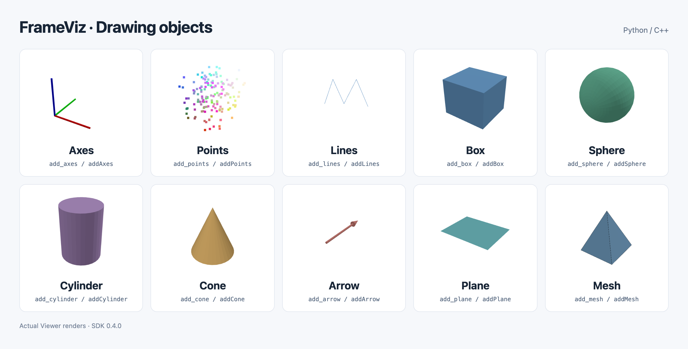
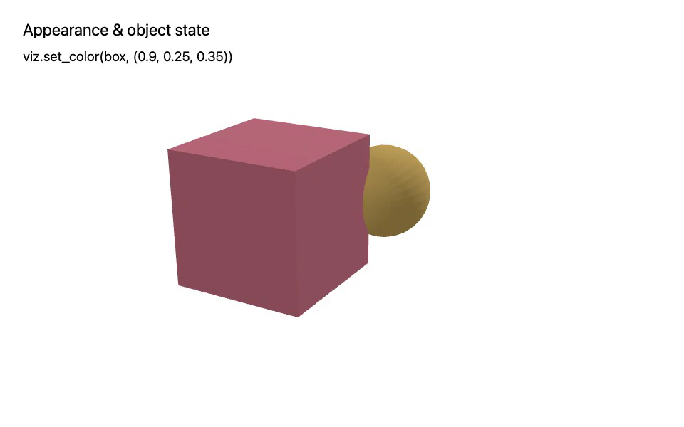
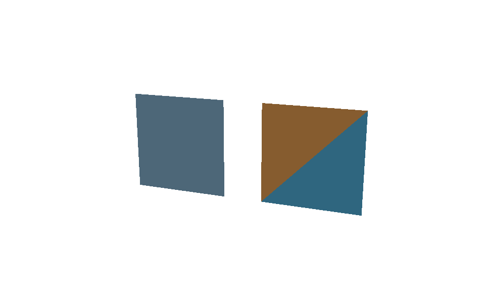
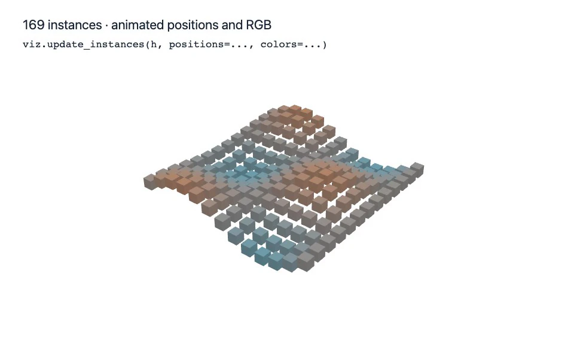
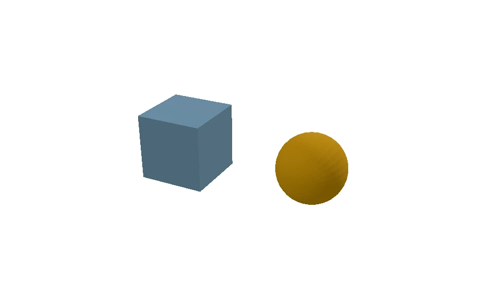
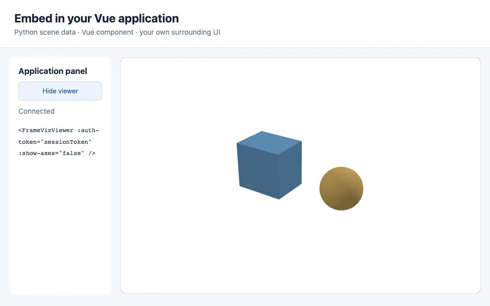

# FrameViz

[中文](README.zh-CN.md) · [Examples](examples/README.md) · [API contract](docs/API_Definition.md)

Draw and interact with 3D data from **Python or C++**, in a desktop window, browser, or your **Vue** application. FrameViz provides object handles, NumPy/array input, instancing, camera control, picking events, and transform handles. A local Rust Host keeps scene state; a Three.js viewer renders it.

Version **0.4.0**, private preview. Copyright **qqfly**, [MIT](LICENSE). Third-party attribution: [NOTICE](NOTICE) and [THIRD_PARTY_LICENSES](THIRD_PARTY_LICENSES).

## What can I draw?



| Data or object | Python | C++ | Input |
|---|---|---|---|
| Coordinate frames | `add_axes` | `addAxes` | Length, radius, pose |
| Point clouds | `add_points` | `addPoints` | N×3 positions, optional RGB colors |
| Lines | `add_lines` | `addLines` | Positions, optional segment indices |
| Box, sphere, cylinder, cone, arrow, plane | `add_box`, `add_sphere`, … | `addBox`, `addSphere`, … | Dimensions, pose, color |
| Indexed meshes | `add_mesh` | `addMesh` | Vertices, triangle/polygon faces, optional normals and vertex/face colors |
| Model files | `load_mesh` | `loadMesh` | Served STL or DAE URL |
| Repeated primitives | `add_instances` | `addInstances` | Box/sphere/axes, per-instance positions, orientations, scales and RGB |
| World labels / screen overlays | `add_text_3d` / `add_text_2d` | `addText3D` / `addText2D` | Text, world position / pixel coordinates |

Coordinates and dimensions come from your application. Quaternions use **`[x, y, z, w]`**. See the [API contract](docs/API_Definition.md), [Python signatures](packages/frameviz-py/frameviz/viz.py), and [C++ signatures](packages/frameviz-cpp/include/frameviz/viz.hpp).

## Quick start: Apple Silicon Mac + Python

Install the matching private-preview App from the [repository's releases](https://github.com/qqfly/frameviz/releases), open it once to complete macOS's first-open approval, then install its paired Python wheel:

```sh
python3 -m venv .venv
source .venv/bin/activate
python -m pip install /path/to/SDK/Python/frameviz-0.4.0-py3-none-any.whl
```

```python
import frameviz as fv

viz = fv.open(title="My first scene")
viz.set_view_config(show_axes=False)
box = viz.add_box(size=(1, 1, 1), color=(0.2, 0.5, 0.87))
viz.set_camera_pose(eye=(4, -6, 4), target=(0, 0, 0))
viz.set_transform(box, pos=(0.5, 0, 0))
input("Press Enter to close...")
viz.close()
```

Python discovers and starts the App in the standard Applications locations; no App-path variable is needed. The first manual launch shows the guide; later launches wait in the background. The current App is locally signed and **not Apple-notarized**. See [Mac installation](docs/MACOS.md) for exact packages, Gatekeeper steps, and upgrades.

The SDK is already pip-installable from a wheel or source. A public `pip install frameviz` release with a bundled runtime is **planned, not a supported delivery today**. [Current pip options and distribution plan](docs/PYTHON_DISTRIBUTION.md).

## Developer examples

These are real SDK → Host → viewer captures. Origin helper axes are hidden; the Axes drawing example and functional Gizmo handles remain visible. Data is synthetic; the recordings are not performance benchmarks. [Capture notes and source mapping](docs/media/README.md).

### Color, transparency, visibility, and pose

Keep an object handle and update it:

```python
viz.set_color(box, (0.9, 0.25, 0.35))
viz.set_alpha(box, 0.25)
viz.set_visible(box, False)
viz.set_visible(box, True)
viz.set_transform(box, pos=(0.4, 0, 0.65))
# viz.remove(box) removes one object; viz.clear() clears the scene.
```



Examples: [colors and transparency](examples/python/01_basic_primitives/use_colors_and_transparency.py), [batch transforms](examples/python/01_basic_primitives/use_batch_transforms_and_view_status.py), [object lifecycle](examples/python/01_basic_primitives/use_resource_cleanup.py).

### Mesh data, vertex colors, and wireframe

Pass `float32` vertices and `uint32` triangle indices. Use `colors` for vertex/face RGB, or `color` for a uniform material. `set_color` switches to a uniform color without retaining the old vertex palette.

```python
mesh = viz.add_mesh(vertices, faces, colors=colors, smooth_shading=True)
viz.set_color(mesh, (0.2, 0.55, 0.8))
viz.set_render_mode("wireframe")  # View-level display mode
```



Run the [deterministic mesh example](examples/python/05_developer_features/showcase.py):

```sh
python examples/python/05_developer_features/showcase.py mesh
```

Also see [mesh color modes](examples/python/01_basic_primitives/use_mesh_color_modes.py) and [smooth shading](examples/python/01_basic_primitives/use_mesh_smooth_shading.py).

### Instancing and batch updates

Use one handle for repeated primitives. Provided arrays replace their previous contents. The clip shows **169 box instances**, not a throughput claim.

```python
h = viz.add_instances("box", positions=positions, size=(0.22, 0.22, 0.22), colors=colors)
viz.update_instances(h, positions=next_positions, colors=next_colors)
```



Run `python examples/python/05_developer_features/showcase.py instances`. Sources: [README example](examples/python/05_developer_features/showcase.py), [original instancing example](examples/python/01_basic_primitives/use_instancing.py).

### Picking and Gizmo events

Register callbacks, enable picking, and attach transform handles to a selected object. Call `spin()` or `poll_events()` to dispatch Python events.

```python
viz.set_pick_config(enabled=True, mode="object", button=0)
def picked(event):
    if event.get("handle"):
        viz.attach_gizmo(event["handle"], mask=0x07)  # Translation axes
viz.on_pick(picked)
viz.on_transform(lambda event: print(event))
viz.spin()
```



Run `python examples/python/05_developer_features/showcase.py picking`. Also see [picking](examples/python/03_interaction/use_picking_demo.py) and [Gizmo configuration](examples/python/03_interaction/use_gizmo_config.py).

### Shared scene, independent cameras

Object updates appear in every view bound to a scene; each view keeps its own camera. Separate scenes have independent object sets.

```python
second = fv.open(title="Top view", share_scene=viz.scene_id)
second.set_view_config(show_axes=False)
second.set_camera_pose(eye=(0.01, 0, 8), target=(0, 0, 0.4), up=(0, 1, 0))
```


Examples: [multiple views](examples/python/02_camera_views/use_multi_view_demo.py), [scene isolation](examples/python/02_camera_views/use_multi_view_isolation.py), [camera controls and fit](examples/python/02_camera_views/use_camera_controls_fit_object.py).

### Model URLs and text labels

Load **STL or DAE** from a served URL. The browser loads the model: an arbitrary path on the Python machine is not a model URL. Cross-origin servers must allow the viewer's request. World labels use 3D positions; overlays use screen pixels.

```python
model = viz.load_mesh("http://127.0.0.1:8000/model.stl", color=(0.2, 0.55, 0.8))
label = viz.add_text_3d("Loaded STL", pos=(0, 0, 1.5), color="black")
viz.update_text_3d(label, text="Updated", pos=(0.5, 0, 1.5))
viz.add_text_2d("Status: ready", x=32, y=540, color="black")
```


Run `python examples/python/05_developer_features/showcase.py labels --model-url http://127.0.0.1:8000/model.stl` with your own HTTP-served model. The clip uses a generated tetrahedron, not a third-party model.

### Embed in Vue

Place the component in your application's layout. Supply the Host credential at runtime from your trusted local bootstrap:

```vue
<FrameVizViewer name="main" :auth-token="sessionToken"
  :auto-start-host="false" :show-axes="false" :show-grid="false" />
```



The clip shows Python updating the scene and a real Vue unmount/remount. Restoration is within the **same running Host**, not after Host restart. See the [runnable example](examples/vue/README.md), [Vue setup](packages/frameviz-vue/README.md), and [external application template](templates/frameviz-template-external-app/README.md).

## C++ and further examples

C++ uses the same Host/protocol and object handles, with APIs such as `addMesh`, `updateInstances`, `setCameraPose`, and `attachGizmo`. See [C++ setup](packages/frameviz-cpp/README.md), [C++ examples](examples/cpp/README.md), and the [example index](examples/README.md). The media above was driven by Python, plus the actual Vue component; it is not a separate recording of every C++ example.

Application examples include a [generated robot arm](examples/python/04_robotics/use_robot_arm.py), [dynamic occupancy boxes](examples/python/04_robotics/use_octomap_dynamic.py), and [standalone applications](examples/apps/README.md).

## Build from source

Use Node.js 20+, pnpm 10, Python 3.9+, Rust, CMake, and a C++17 compiler. Network access is needed unless dependency caches are complete.

```sh
pnpm install --frozen-lockfile
python3 -m venv .venv
.venv/bin/python -m pip install -e 'packages/frameviz-py[dev]' build playwright websockets
node scripts/prepare_web_viewer_dist.mjs
pnpm --filter @frameviz/vue build
cargo build --locked --manifest-path packages/frameviz-server/Cargo.toml
```

On Windows, replace `.venv/bin/python` with `.venv/Scripts/python.exe`. Run `.venv/bin/python tests/acceptance/demo.py` for an isolated scene. To include Vue, first run `pnpm --filter @frameviz/vue exec vite build --config vite.acceptance.config.mjs`, then pass `--vue-dist packages/frameviz-vue/dist-acceptance` to the demo. Stop with Ctrl+C.

For source development, start `cargo run --manifest-path packages/frameviz-server/Cargo.toml -- 9527`. It binds loopback and requires a token from its matching discovery record. [Installation](docs/INSTALLATION.md) describes SDK and runtime paths.

## Scope and support

All Host, SDK, viewer, and template components must use protocol **0.4.0**. Missing or different versions are rejected. Use App/SDK artifacts from the same preview; a version string alone does not identify a preview build.

The acceptance target is local single-user use. Remote multi-user authorization, shared-memory upload, persistence across Host restart, production load limits, and signed cross-platform installers remain outside this preview's acceptance. Software WebGL captures are not hardware GPU benchmarks.

[Architecture](docs/ARCHITECTURE.md) · [Compatibility](docs/COMPATIBILITY.md) · [Validation](docs/VALIDATION.md) · [Release checks](docs/RELEASING.md) · [Contributing](CONTRIBUTING.md) · [Security](SECURITY.md)
