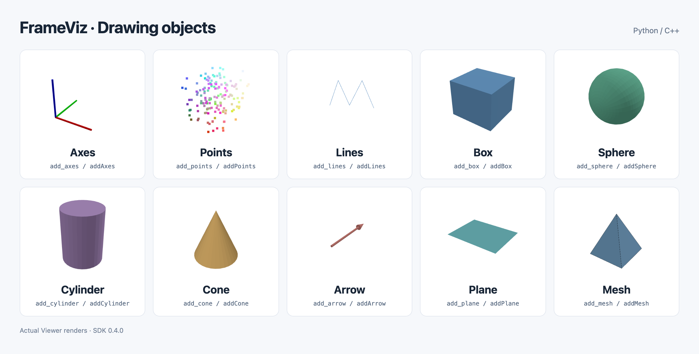
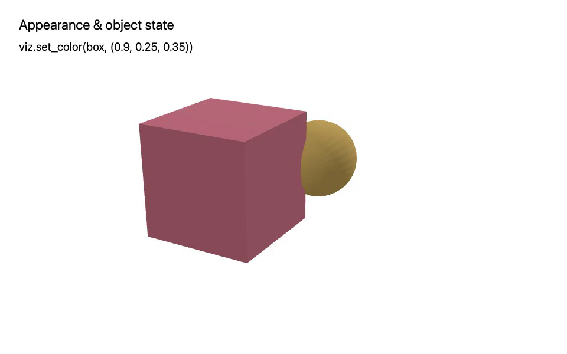
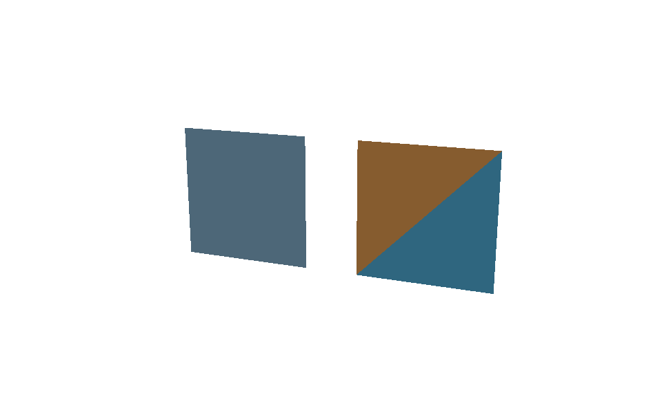
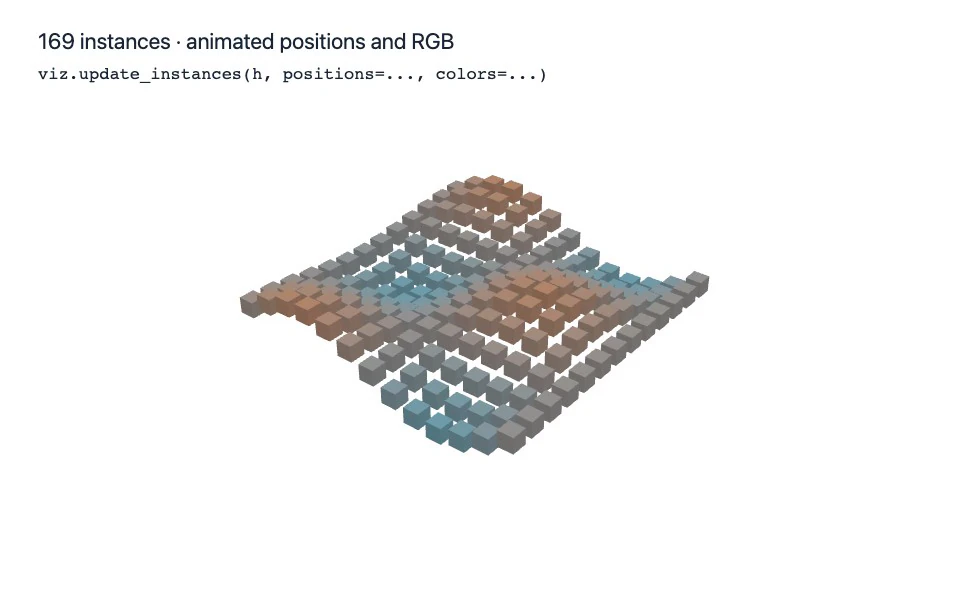
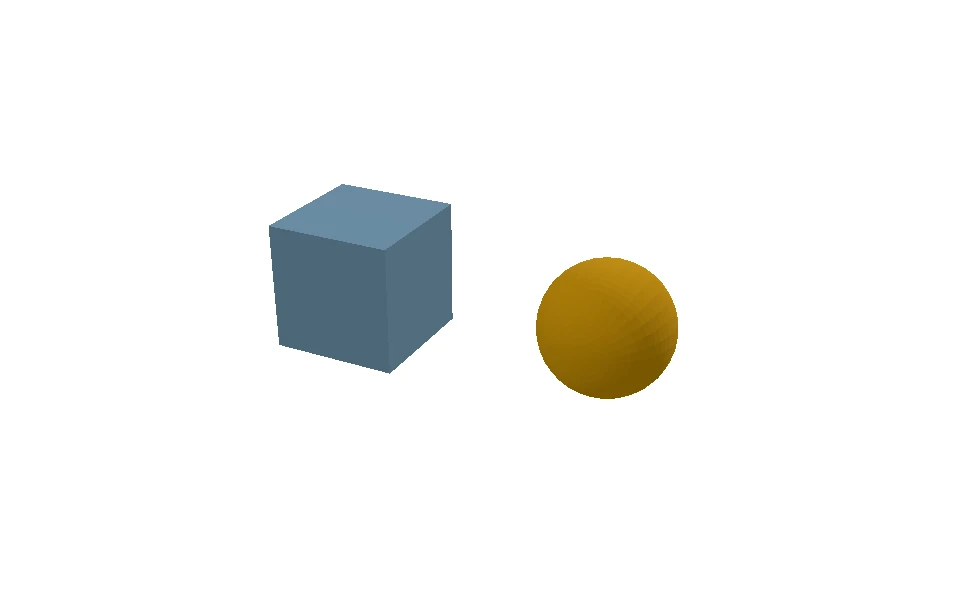
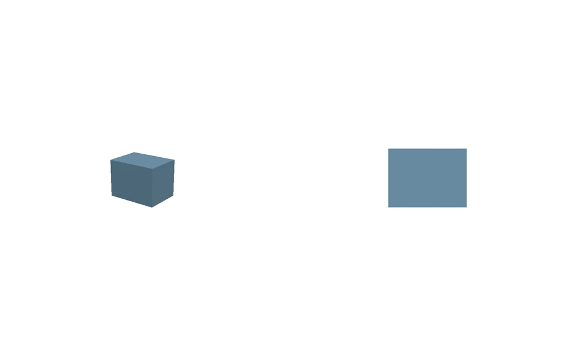
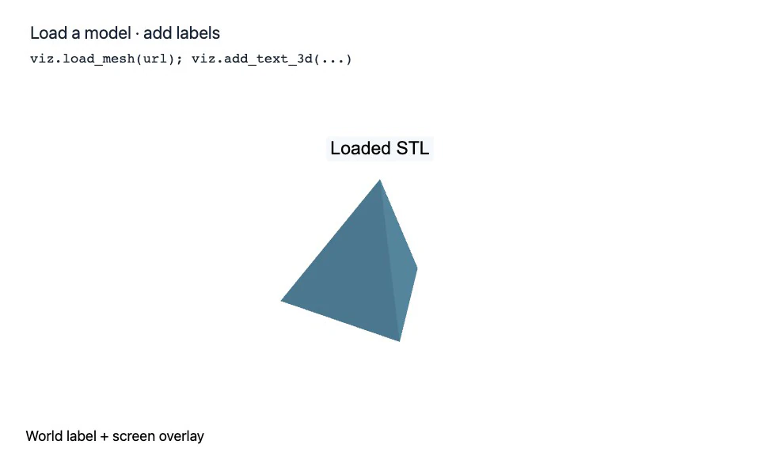
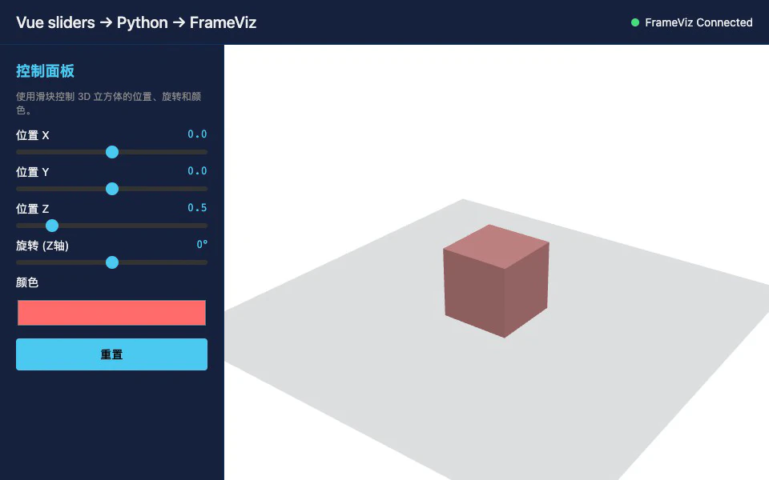
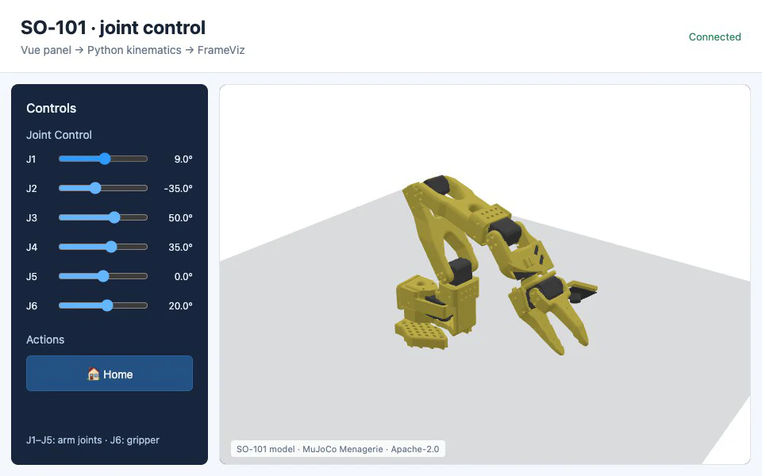

# FrameViz

[English](README.md) · [示例目录](examples/README.md) · [API 约定](docs/API_Definition.md)

用 **Python 或 C++** 绘制并交互操作三维数据，显示在桌面窗口、浏览器或你的 **Vue** 应用里。FrameViz 提供对象句柄、NumPy/数组输入、实例化、相机控制、拾取事件和 Gizmo。Rust Host 在本地维护场景，Three.js Viewer 负责渲染。

当前为 **0.4.0 私有预览版**。版权 **qqfly**，采用 [MIT](LICENSE) 许可证。第三方署名与许可见 [NOTICE](NOTICE) 和 [THIRD_PARTY_LICENSES](THIRD_PARTY_LICENSES)。

## 可以绘制什么？



| 数据或对象 | Python | C++ | 输入方式 |
|---|---|---|---|
| 坐标系 | `add_axes` | `addAxes` | 长度、半径、位姿 |
| 点云 | `add_points` | `addPoints` | N×3 坐标，可选 RGB 颜色 |
| 线段 | `add_lines` | `addLines` | 顶点，可选线段索引 |
| 盒、球、圆柱、圆锥、箭头、平面 | `add_box`、`add_sphere` 等 | `addBox`、`addSphere` 等 | 尺寸、位姿、颜色 |
| 索引网格 | `add_mesh` | `addMesh` | 顶点、三角形/多边形面，可选法线和逐顶点/逐面颜色 |
| 模型文件 | `load_mesh` | `loadMesh` | 服务提供的 STL / DAE URL |
| 重复图元 | `add_instances` | `addInstances` | 盒/球/坐标系，逐实例位置、四元数、缩放和 RGB |
| 三维标注 / 屏幕文字 | `add_text_3d` / `add_text_2d` | `addText3D` / `addText2D` | 文字、世界坐标 / 屏幕像素坐标 |

坐标与尺寸由你的应用提供；四元数按 **`[x, y, z, w]`** 排列。输入约定见 [API 文档](docs/API_Definition.md)，具体语言签名见 [Python](packages/frameviz-py/frameviz/viz.py) 与 [C++](packages/frameviz-cpp/include/frameviz/viz.hpp)。

## 快速开始：Apple 芯片 Mac + Python

从[私有仓库的 Releases](https://github.com/qqfly/frameviz/releases) 安装匹配的预览版 App，首次手动打开完成 macOS 的允许打开操作，再在你的项目环境安装配套 wheel：

```sh
python3 -m venv .venv
source .venv/bin/activate
python -m pip install /path/to/SDK/Python/frameviz-0.4.0-py3-none-any.whl
```

```python
import frameviz as fv

viz = fv.open(title="My first scene")
viz.set_view_config(show_axes=False)
box = viz.add_box(size=(1, 1, 1), color=(0.2, 0.5, 0.87))
viz.set_camera_pose(eye=(4, -6, 4), target=(0, 0, 0))
viz.set_transform(box, pos=(0.5, 0, 0))
input("按 Enter 关闭...")
viz.close()
```

Python 会自动查找并启动标准 Applications 目录里的 App，无需设置 App 路径变量。首次手动启动显示使用指南，之后在后台待命。当前 App 使用本地签名，**尚未 Apple 公证**；具体包、允许打开方式和升级步骤见 [Mac 使用说明](docs/MACOS.md)。

SDK 已支持通过 pip 安装 wheel 或源码；包含完整运行时的公共 `pip install frameviz` **尚未作为正式交付提供**。[当前 pip 用法与后续简化方案](docs/PYTHON_DISTRIBUTION.md)。

## 开发者功能案例

下面是实际 SDK → Host → Viewer 的短动图。采集时隐藏世界原点的辅助轴；主动绘制的 Axes 图元和交互需要的 Gizmo 手柄仍保留。基础场景使用合成数据；SO-101 使用有来源声明的外部模型与合成关节输入。动图不构成性能测试。[采集规范与源码对应](docs/media/README.md)。

### 颜色、透明度、显隐与位姿

创建对象后保存句柄，继续修改同一个对象：

```python
viz.set_color(box, (0.9, 0.25, 0.35))
viz.set_alpha(box, 0.25)
viz.set_visible(box, False)
viz.set_visible(box, True)
viz.set_transform(box, pos=(0.4, 0, 0.65))
# viz.remove(box) 删除单个对象；viz.clear() 清空场景。
```



对应示例：[颜色与透明度](examples/python/01_basic_primitives/use_colors_and_transparency.py)、[批量变换](examples/python/01_basic_primitives/use_batch_transforms_and_view_status.py)、[对象生命周期](examples/python/01_basic_primitives/use_resource_cleanup.py)。

### 网格输入、顶点颜色与线框

传入 `float32` 顶点和 `uint32` 三角形索引。`colors` 提供逐顶点/逐面 RGB，`color` 提供统一材质颜色。调用 `set_color` 会切换为统一颜色，不保留之前的顶点调色数据。

```python
mesh = viz.add_mesh(vertices, faces, colors=colors, smooth_shading=True)
viz.set_color(mesh, (0.2, 0.55, 0.8))
viz.set_render_mode("wireframe")  # 整个视图的显示模式
```



运行[固定输入示例](examples/python/05_developer_features/showcase.py)：

```sh
python examples/python/05_developer_features/showcase.py mesh
```

另见[网格颜色模式](examples/python/01_basic_primitives/use_mesh_color_modes.py)、[平滑着色](examples/python/01_basic_primitives/use_mesh_smooth_shading.py)。

### 实例化与批量更新

用一个句柄管理重复图元，一次更新位置与颜色；传入的数组整体替换对应数据。动图展示 **169 个盒子实例**，不代表吞吐量承诺。

```python
h = viz.add_instances("box", positions=positions, size=(0.22, 0.22, 0.22), colors=colors)
viz.update_instances(h, positions=next_positions, colors=next_colors)
```



运行 `python examples/python/05_developer_features/showcase.py instances`。源码：[README 案例](examples/python/05_developer_features/showcase.py)、[原实例化示例](examples/python/01_basic_primitives/use_instancing.py)。

### 拾取与 Gizmo 事件

注册回调、启用拾取，为选中的对象附加平移/旋转手柄。Python 需要通过 `spin()` 或 `poll_events()` 分发事件。

```python
viz.set_pick_config(enabled=True, mode="object", button=0)
def picked(event):
    if event.get("handle"):
        viz.attach_gizmo(event["handle"], mask=0x07)  # 允许三个方向平移
viz.on_pick(picked)
viz.on_transform(lambda event: print(event))
viz.spin()
```



运行 `python examples/python/05_developer_features/showcase.py picking`。另见[拾取示例](examples/python/03_interaction/use_picking_demo.py)、[Gizmo 配置](examples/python/03_interaction/use_gizmo_config.py)。

### 共享场景与独立相机

多个视图可以显示同一个场景，对象更新会同步到所有绑定的视图，各视图保留自己的相机。不同场景则拥有独立对象集合。

```python
second = fv.open(title="Top view", share_scene=viz.scene_id)
second.set_view_config(show_axes=False)
second.set_camera_pose(eye=(0.01, 0, 8), target=(0, 0, 0.4), up=(0, 1, 0))
```



对应示例：[多视图](examples/python/02_camera_views/use_multi_view_demo.py)、[场景隔离](examples/python/02_camera_views/use_multi_view_isolation.py)、[相机控制与适配对象](examples/python/02_camera_views/use_camera_controls_fit_object.py)。

### 模型 URL 与文字标注

从服务提供的 URL 加载 **STL 或 DAE**。模型由浏览器加载，Python 所在机器上的任意文件路径并不是可用的模型 URL；跨域服务需要允许 Viewer 请求。三维标注随世界坐标定位，二维文字按屏幕像素定位。

```python
model = viz.load_mesh("http://127.0.0.1:8000/model.stl", color=(0.2, 0.55, 0.8))
label = viz.add_text_3d("Loaded STL", pos=(0, 0, 1.5), color="black")
viz.update_text_3d(label, text="Updated", pos=(0.5, 0, 1.5))
viz.add_text_2d("Status: ready", x=32, y=540, color="black")
```



用你自己通过 HTTP 提供的模型运行 `python examples/python/05_developer_features/showcase.py labels --model-url http://127.0.0.1:8000/model.stl`。动图使用程序生成的四面体，不包含第三方模型。

### Vue 滑动条 → Python 后端 → 三维场景

将 Viewer 放到实际应用的控制面板旁。本案例直接复用[现有 Simple Slider 应用](examples/apps/simple_slider/README.md)：X/Y/Z 滑动条修改盒子位置，第四个滑动条控制旋转，“重置”恢复初始位姿。

```vue
<ControlPanel :box-handle="boxHandle" @update-transform="handleUpdateTransform" />
<FrameVizViewer name="simple_slider_viewer" :view-id="viewId" />
```

控制面板向经过认证的 Python 业务后端发送 `set_box_pose`，后端调用 `viz.set_transform(handle, pos=..., quat=...)`，Viewer 显示 Host 更新后的场景。Host 与业务通道使用独立凭据，由启动流程在运行时提供。



准备好源码依赖、Python SDK 和匹配的 App/Host 后：

```sh
python -m pip install -r examples/apps/simple_slider/python/requirements.txt
pnpm --filter simple-slider-app build
python examples/apps/simple_slider/python/run_browser_demo.py
```

启动器会打开带有临时凭据的本地页面；在启动终端按 Enter 结束本次演示。参见[启动说明与交互链路](examples/apps/simple_slider/README.md)、[控制面板](examples/apps/simple_slider/src/components/ControlPanel.vue)、[Python 后端](examples/apps/simple_slider/python/backend_simple_slider.py)和 [Vue SDK](packages/frameviz-vue/README.md)。[最小组件接入示例](examples/vue/README.md)仍保留，便于初次嵌入。机器人关节应用是另一类接入示例，其当前公开模型为占位几何，并非真实物理机器人模型。


### SO-101 机械臂模型与关节控件

用同一套 Viewer 和对象位姿 API 显示真实机械臂模型。本动图展示通过 Vue 控件操作 **SO-101 的五个手臂关节和夹爪**，最后恢复初始姿态。SO-101 是 [LeRobot 官方支持的平台](https://huggingface.co/docs/lerobot/so101)。



模型来自 [MuJoCo Menagerie SO-101](https://github.com/google-deepmind/mujoco_menagerie/tree/98a70c569c4c1b6da467a20012f766ee1f8dc521/robotstudio_so101)，固定版本 `98a70c569c4c1b6da467a20012f766ee1f8dc521`，采用 [Apache-2.0 许可](docs/media/LICENSE-so101-model.txt)。**模型文件不进入本仓库**，仅提供录制的 WebP 和来源声明。短循环采用 1.5 倍速回放，不代表渲染或更新速率。

采集复用现有[关节面板](examples/apps/urdf_robot/src/components/ControlPanel.vue)，由仓库外的适配器读取 MJCF 关节定义，向 FrameViz 提交 STL URL 与各部件位姿。适配器的运动学已与 MuJoCo `mj_forward` 对照，画面由 FrameViz 渲染。本次媒体更新不新增内置 MJCF/URDF 导入器或配套 SO-101 应用。[采集来源说明](docs/media/README.md#so-101-external-model)。

## C++ 与更多案例

C++ SDK 使用同一 Host/协议与对象句柄流程，API 采用 `addMesh`、`updateInstances`、`setCameraPose`、`attachGizmo` 等驼峰命名。参见 [C++ 安装](packages/frameviz-cpp/README.md)、[C++ 示例](examples/cpp/README.md)和[示例索引](examples/README.md)。上述动图由 Python 驱动，Vue 案例使用真实组件；并非逐项重新录制了 C++ 示例。

应用场景还包括[合成机械臂](examples/python/04_robotics/use_robot_arm.py)、[动态占据盒](examples/python/04_robotics/use_octomap_dynamic.py)和[独立应用](examples/apps/README.md)。

## 从源码构建

需要 Node.js 20+、pnpm 10、Python 3.9+、Rust、CMake 与 C++17 编译器。依赖缓存不完整时需要网络。

```sh
pnpm install --frozen-lockfile
python3 -m venv .venv
.venv/bin/python -m pip install -e 'packages/frameviz-py[dev]' build playwright websockets
node scripts/prepare_web_viewer_dist.mjs
pnpm --filter @frameviz/vue build
cargo build --locked --manifest-path packages/frameviz-server/Cargo.toml
```

Windows 将 `.venv/bin/python` 替换为 `.venv/Scripts/python.exe`。运行隔离演示可使用 `.venv/bin/python tests/acceptance/demo.py`。若包含 Vue，先执行 `pnpm --filter @frameviz/vue exec vite build --config vite.acceptance.config.mjs`，再给演示传入 `--vue-dist packages/frameviz-vue/dist-acceptance`。Ctrl+C 结束。

源码开发也可用 `cargo run --manifest-path packages/frameviz-server/Cargo.toml -- 9527` 启动服务；服务绑定回环地址，需要匹配发现记录中的会话凭据。SDK 与运行时的区别见[安装说明](docs/INSTALLATION.md)。

## 兼容范围与限制

Host、SDK、Viewer 和模板必须使用 **0.4.0 协议**，缺失或不同版本会被拒绝。请使用同一预览版配套 App/SDK；相同版本号本身不能唯一标识预览构建。

当前验收目标为本地单用户使用。远程多用户授权、共享内存上传、Host 重启持久恢复、生产负载上限和签名跨平台安装包，仍不属于本预览版的已验收范围。浏览器采集使用软件 WebGL，不能据此判断硬件 GPU 性能。

[架构](docs/ARCHITECTURE.md) · [兼容性](docs/COMPATIBILITY.md) · [验证说明](docs/VALIDATION.md) · [发布检查](docs/RELEASING.md) · [贡献指南](CONTRIBUTING.md) · [安全反馈](SECURITY.md)
