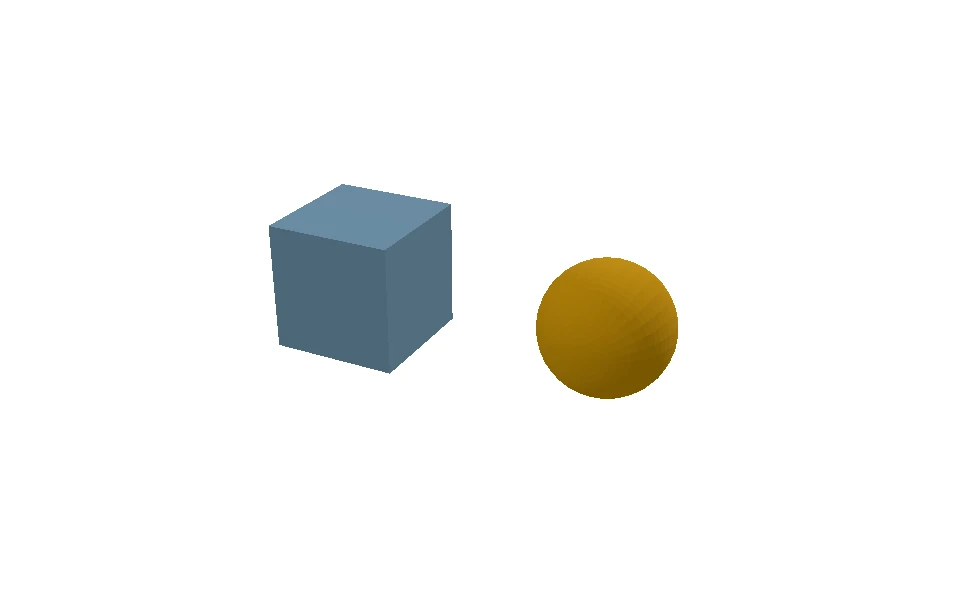

# FrameViz

FrameViz is an interactive 3D viewer for robotics and geometry code. Draw a scene from Python and send selections and pose changes from the viewer back to your program. Move a robot's goal in 3D, for example, and see the trajectory your code computes for the new goal.



Try the [Gizmo example](https://github.com/qqfly/frameviz/blob/138945679667a8361a3dcac35152da68482049e7/examples/python/03_interaction/use_gizmo.py) shown here or the [interactive trajectory example](https://github.com/qqfly/frameviz/blob/138945679667a8361a3dcac35152da68482049e7/examples/python/03_interaction/use_target_trajectory.py).

## What you can do

- **Check how geometry lines up.** Draw NumPy point clouds, triangle meshes, coordinate frames, and labels in one scene. Attach geometry to a parent frame so it follows a sensor or robot link when you update its pose. [Supported geometry](https://github.com/qqfly/frameviz/blob/main/docs/media/drawables-overview.png)
- **Build an interactive tool around your code.** Get the index of a picked point, read a dragged object's new pose, or add a slider that calls your Python code to update the scene. [Python examples](https://github.com/qqfly/frameviz/tree/main/examples/python)
- **View the same scene in different ways.** Compare a top view with an oblique view as your program updates the scene. Use a desktop window, a browser, or an embedded viewport in your own Vue app. [Multiple views](https://github.com/qqfly/frameviz/blob/138945679667a8361a3dcac35152da68482049e7/examples/python/02_camera_views/use_multi_view.py) · [Vue example](https://github.com/qqfly/frameviz/tree/138945679667a8361a3dcac35152da68482049e7/examples/apps/simple_slider)

## Install

FrameViz requires Python 3.9 or newer. The same commands set up the local viewer on Apple Silicon Macs and Ubuntu 22.04 or 24.04 (x86-64).

```sh
python -m pip install frameviz
python -m frameviz install-host
```

The second command installs the matching runtime once for this version under your user account. On an Ubuntu server without a desktop session it installs the standalone Host. After installation you can start the viewer offline. Use `frameviz.install_host()` to run the same setup from a notebook. See the [installation guide](https://github.com/qqfly/frameviz/blob/main/docs/INSTALLATION.md) for local builds and offline setup.

## Try dragging a pose

```python
import frameviz as fv

viz = fv.open()
goal = viz.add_axes(position=[0, 0, 0.5], length=0.4, name="Goal")
viz.set_camera_pose([2, -3, 2], [0, 0, 0.5])
viz.attach_gizmo(goal, size=0.6)
viz.on_transform(lambda event: print(event["world_transform"], flush=True))
viz.keep_running()
```

Run this as a script, then drag the arrows or rings in the viewer. The terminal prints the new world pose. Press Ctrl+C to finish.

## Share a scene

Save a PNG for a report or export a standalone HTML scene for a tutorial. Readers can orbit and zoom in their browser without installing FrameViz. Export requires `python -m pip install 'frameviz[capture]'` and `python -m playwright install chromium`.

[Python API reference](https://github.com/qqfly/frameviz/blob/main/docs/API_Definition.md) · [Distribution guide](https://github.com/qqfly/frameviz/blob/main/docs/PYTHON_DISTRIBUTION.md)
