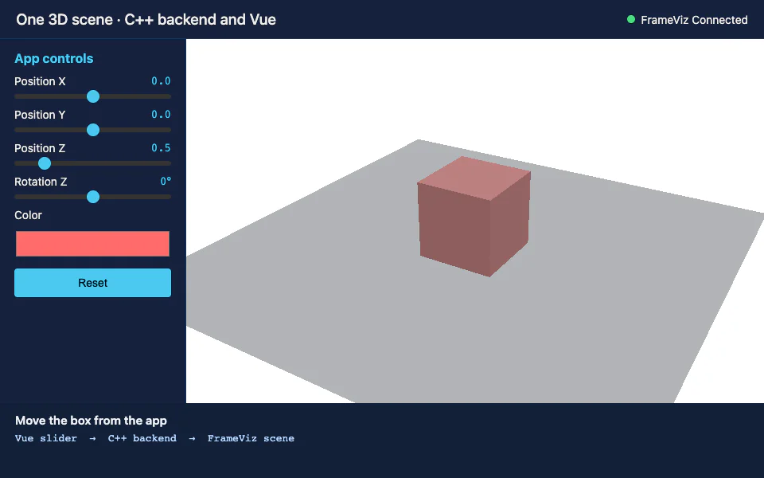
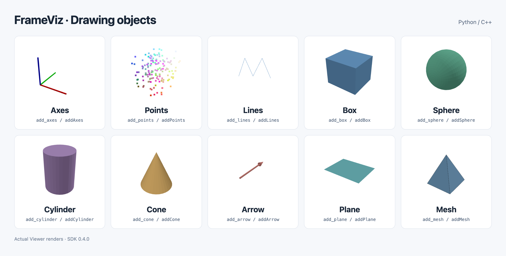

# FrameViz

FrameViz gives Python and C++ programs an interactive 3D interface. Open a desktop window from IPython to inspect your data, or embed the viewer in your own Vue app. Both use the same scene API and support point picking and pose editing.



In this demo, the Vue slider moves a box in a scene created by C++. Python then attaches to the running view with `fv.connect()` and moves the same box again. The embedded viewport shows both updates. [Vue and C++ example](https://github.com/qqfly/frameviz/blob/main/examples/apps/simple_slider/README.md)

## Work with your own geometry



- **Inspect your data in context.** Draw points, lines, meshes, coordinate frames, and labels together. Attach geometry to a sensor or robot link so it follows the parent pose. Open a second view for an independent camera. [Scene tree](https://github.com/qqfly/frameviz/blob/main/examples/python/05_scene/use_scene_tree.py) · [Multiple views](https://github.com/qqfly/frameviz/blob/main/examples/python/02_camera_views/use_multi_view.py)
- **Make the viewer an input to your program.** Click a point to look up its input array index. Drag a goal pose to recompute and redraw a path with your own code. Add sliders for interactive tuning. [Point picking](https://github.com/qqfly/frameviz/blob/main/examples/python/03_interaction/use_picking.py) · [Interactive trajectory](https://github.com/qqfly/frameviz/blob/main/examples/python/03_interaction/use_target_trajectory.py) · [Widgets](https://github.com/qqfly/frameviz/blob/main/examples/python/03_interaction/use_widget_panel.py)

The [SO-101 example](https://github.com/qqfly/frameviz/blob/main/examples/python/04_robotics/extra/README.md) combines mesh geometry, parent-relative poses, and joint sliders in one scene.

## Install

FrameViz requires Python 3.9 or newer. The same commands set up the local viewer on Apple Silicon Macs and Ubuntu 22.04 or 24.04 (x86-64).

```sh
python -m pip install frameviz
python -m frameviz install-host
```

The second command installs the matching runtime once for this version under your user account. On an Ubuntu server without a desktop session it installs the standalone Host. After installation you can start the viewer offline. Use `frameviz.install_host()` to run the same setup from a notebook. See the [installation guide](https://github.com/qqfly/frameviz/blob/main/docs/INSTALLATION.md) for local builds and offline setup.

## Start in Python or IPython

```python
import frameviz as fv
import numpy as np

viz = fv.open()
sensor = viz.add_axes(length=0.5)
points = np.array([[0.2, 0, 0.4], [0.4, 0.2, 0.5], [0.3, -0.2, 0.7]])
viz.add_points(points, parent=sensor, size=12, color="#2563eb")
```

Run these lines in IPython and keep adding or moving objects. In a standalone script, add `viz.keep_running()` at the end and press Ctrl+C to finish. [Python and C++ example index](https://github.com/qqfly/frameviz/blob/main/examples/INVENTORY.md)

## Share a scene

Create a PNG from a temporary camera, even with no viewer window open. For a tutorial, export a standalone HTML scene with an optional precomputed pose animation. Readers can orbit the scene, play or seek the animation, and open the page offline in their browser. Export requires `python -m pip install 'frameviz[capture]'` and `python -m playwright install chromium`. [PNG example](https://github.com/qqfly/frameviz/blob/main/examples/python/06_scene_output/save_png.py) · [Offline HTML example](https://github.com/qqfly/frameviz/blob/main/examples/python/06_scene_output/export_html.py)

[Python API reference](https://github.com/qqfly/frameviz/blob/main/docs/API_Definition.md) · [Distribution guide](https://github.com/qqfly/frameviz/blob/main/docs/PYTHON_DISTRIBUTION.md)
